# Flutter Record

一个通过可运行 Demo 学习 Flutter 的仓库。每个示例围绕一个具体问题展开，用页面交互、源码和学习笔记一起说明“为什么会这样，以及怎样处理”。

当前学习项目位于 [flutter_study](flutter_study/README.md)，基于 Flutter Foundation Kit 组织，覆盖布局、状态管理、重绘优化、异步计算、本地存储和平台互操作。

## 效果预览

以下为 iPhone 15 模拟器实际运行截图，页面文字以项目当前实现为准。

### Key 与状态归属

给两组的 A 分别增加一次计数，再交换顺序。无 Key 组的颜色和计数保留在原来的位置，稳定 ValueKey 组的状态跟着项目移动。

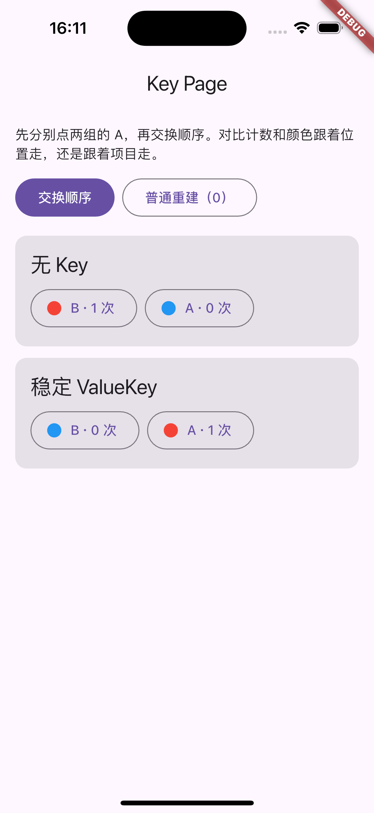

[示例源码](flutter_study/lib/module/usecase/pages/widget_keys/KeyPage.dart) · [Key 学习笔记](flutter_study/lib/module/usecase/pages/widget_keys/CSDN.md)

### Expanded 与长文字越界

同一段文字直接放在 Row 中会超出可用宽度，调试模式显示越界条纹。用 Expanded 包住文字后，Row 分配剩余宽度，文字在这个宽度内换行。上方示例刻意保留越界，方便观察。

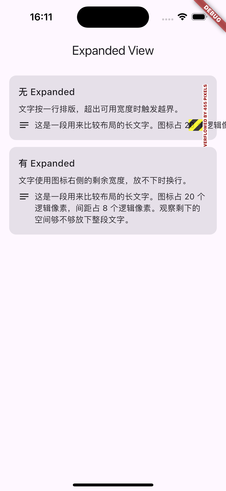

[页面入口](flutter_study/lib/module/usecase/pages/layout/ExpandedPage.dart) · [约束与换行原理](flutter_study/lib/module/usecase/pages/layout/CSDN.md)

### Cubit、Bloc 与事件处理

两组分别用方法调用和枚举事件表达加减意图。Bloc 显示事件以及更新前后的状态。继续向下滚动，可以用模拟照片上传对照并发、排队、忽略重复和最新优先四种策略。

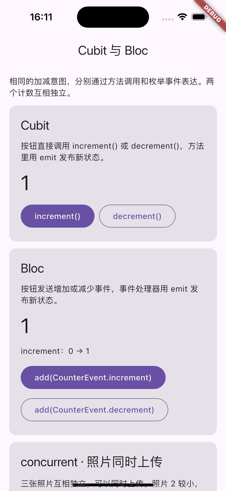

[页面与操作说明](flutter_study/lib/module/usecase/pages/bloc/README.md) · [面试学习笔记](flutter_study/lib/module/usecase/pages/bloc/CSDN.md)

### Canvas 图形与动态绘制

下面的 GIF 和截图来自模拟器中的 Canvas 示例。圆环、仪表盘、水波纹和动画渐变保留了连续帧，便于观察绘制随时间变化的效果。

| 进度圆环 | 仪表盘 |
| --- | --- |
| 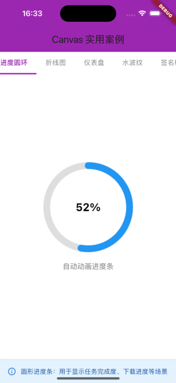 | 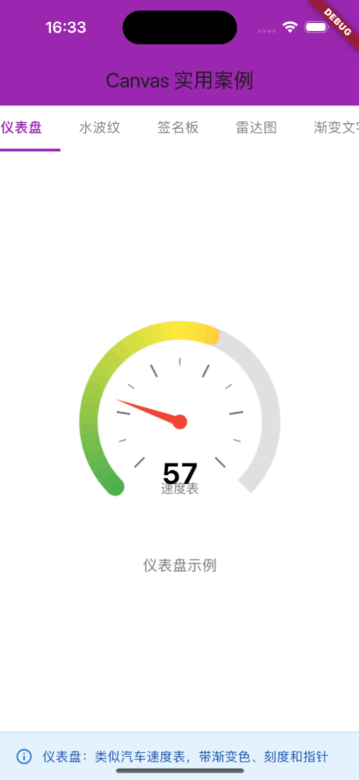 |

| 水波纹 | 动画渐变文字 |
| --- | --- |
| 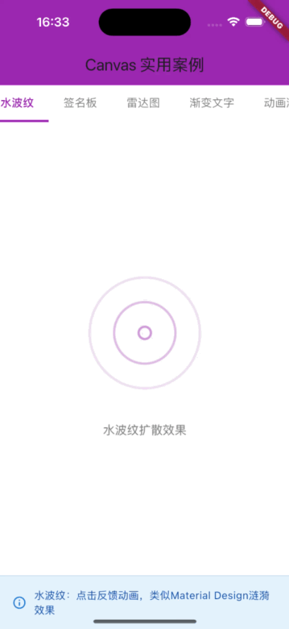 | 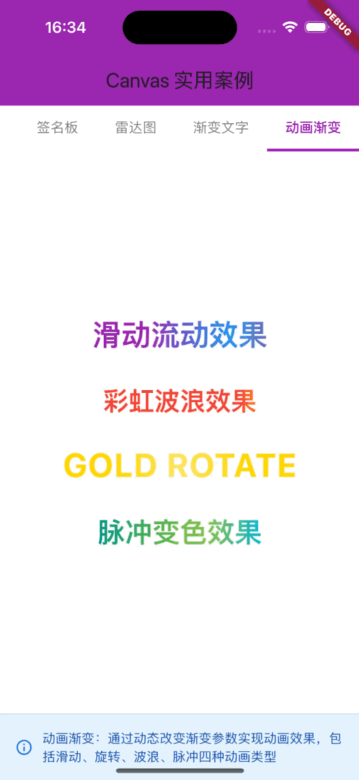 |

| 基础图形 | 折线图 |
| --- | --- |
| 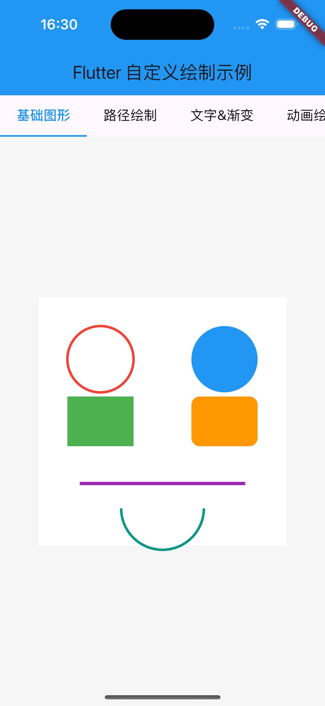 | 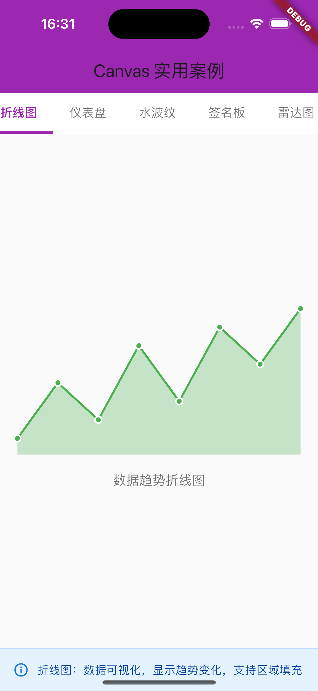 |

| 雷达图 | 渐变文字 |
| --- | --- |
| 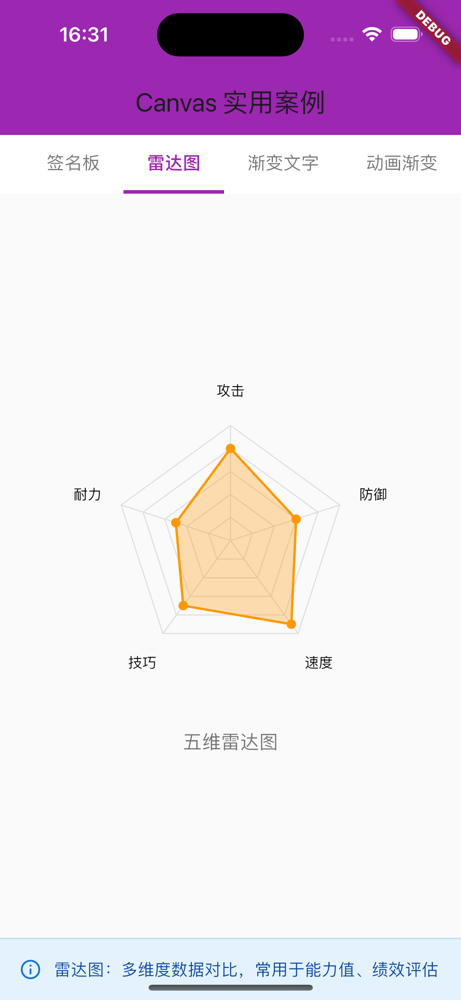 | 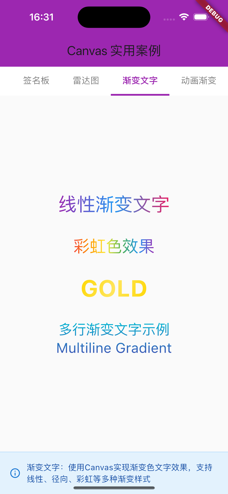 |

签名板支持手写路径，可查看实际绘制结果。

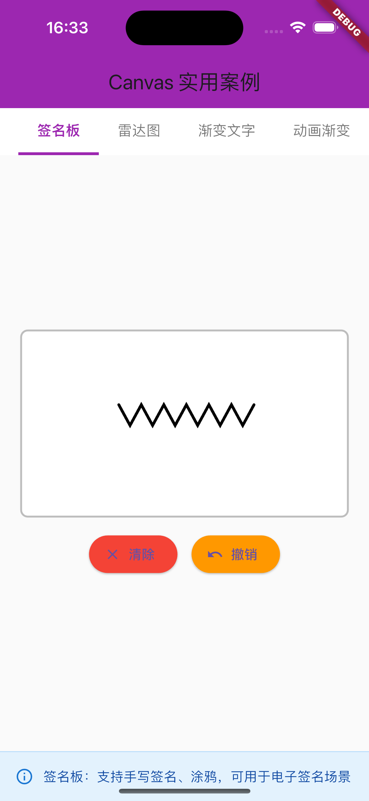

[Canvas 示例与教程](flutter_study/lib/module/usecase/pages/canvas/README.md)

## 可以学到什么？

| 主题 | 可以动手观察的内容 | 入口文档 |
| --- | --- | --- |
| ListView 与 KeepAlive | 滚动后计数丢失、保活和模型保存状态 | [列表](flutter_study/lib/module/usecase/pages/list/README.md) |
| Key | 重排时 Widget 与 State 的匹配 | [Key](flutter_study/lib/module/usecase/pages/widget_keys/README.md) |
| 布局约束 | Row 长文字越界、Expanded 分配剩余宽度 | [布局](flutter_study/lib/module/usecase/pages/layout/README.md) |
| 状态管理 | Provider、Riverpod、Cubit 和 Bloc 的状态更新 | [Provider](flutter_study/lib/module/usecase/pages/provider/README.md) · [Riverpod](flutter_study/lib/module/usecase/pages/riverprovider/README.md) · [Bloc](flutter_study/lib/module/usecase/pages/bloc/README.md) |
| 异步计算 | Isolate.run、compute 和界面响应 | [Isolate](flutter_study/lib/module/usecase/pages/isolate/README.md) |
| 本地存储 | Secure Storage、Hive、SharedPreferences、SQLite 对象读写 | [Storage](flutter_study/lib/module/usecase/pages/storage/README.md) |
| 重绘隔离 | 动画期间的 paint 日志与 RepaintBoundary | [RepaintBoundary](flutter_study/lib/module/usecase/pages/repaintboundary/README.md) |
| 动画与手势 | 页面滑入、下拉返回 | [Animation](flutter_study/lib/module/usecase/pages/animation/README.md) |
| 点击命中 | 留白、重叠组件与 HitTestBehavior | [Hit Test](flutter_study/lib/module/usecase/pages/hit_test/README.md) |
| 平台互操作 | Native Channel、Pigeon、原生视图和 Flutter 页面 | [Platform](flutter_study/lib/module/usecase/pages/platform/README.md) |

更多示例见 [项目教程目录](flutter_study/README.md#演示与教程)。各主题下的 CSDN.md、CSDN.MD 或 MSDN.MD 提供面向初学者的解释和资料链接。

## 运行

当前项目使用 Flutter 3.41.9，在 Flutter 项目目录运行命令：

```bash
cd flutter_study
flutter pub get
make gen-l10n
make gen
flutter run
```

启动后从首页选择 Demo。新增入口排列在列表前面，入口名称优先使用英文。平台插件的实际能力取决于目标平台，原生互操作示例请使用相应的 iOS 或 Android 设备。

## 验证

```bash
cd flutter_study
make analyze
make test
```

部分示例会有意触发布局溢出或输出生命周期日志，操作前可阅读该主题的 README。需要设备的集成测试位于 integration_test，具体命令见 [项目运行说明](flutter_study/README.md)。

## 仓库结构

```text
flutter_record/
├── flutter_study/                    Flutter 学习项目
│   ├── lib/module/usecase/pages/     按主题组织的 Demo
│   ├── lib/module/route/             页面路由
│   ├── lib/base/                     接口、数据与共享状态
│   ├── lib/infra/                    具体实现
│   ├── docs/images/                  README 效果截图与 GIF
│   ├── test/                         单元与 Widget 测试
│   └── integration_test/             设备集成测试
└── .github/workflows/                CI 工作流
```

提交改动前请阅读 [仓库约定](AGENTS.md) 和 [Flutter 项目约定](flutter_study/AGENTS.md)。
