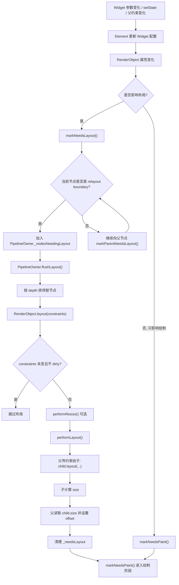

# Flutter 布局原理彻底讲透：从 RenderObject 源码看 Constraints、Size 和 Overflow

> 本文从 Flutter SDK 源码出发，拆解布局阶段到底做了什么：父节点如何给子节点传递约束，子节点如何计算尺寸，父节点又如何决定子节点的位置。文章基于本机 Flutter SDK `3.41.9 stable` 源码阅读，核心文件包括 `rendering/object.dart`、`rendering/box.dart`、`rendering/proxy_box.dart`、`rendering/shifted_box.dart`、`rendering/flex.dart`、`widgets/container.dart`。

## 摘要

Flutter 的布局不是“子组件想多大就多大”，而是一套非常明确的协议：

1. 父 RenderObject 向子 RenderObject 传入 `Constraints`。
2. 子 RenderObject 必须在约束范围内计算出自己的 `Size`。
3. 父 RenderObject 根据子节点的尺寸，决定子节点的 `offset`。
4. 布局完成后，如果尺寸或位置变化，通常会继续触发绘制阶段。

用一句话总结就是：

> 约束向下传递，尺寸向上返回，位置由父节点决定。

这句话几乎可以解释 Flutter 大部分布局现象，比如为什么 `Container(width: 100)` 在某些父组件里不一定真的显示 100，为什么 `Row` 里直接放一个很长的 `Text` 会溢出，为什么 `Expanded` 只能放在 `Flex` 家族组件下面。

## 一、先看 Flutter 布局主流程

Flutter 渲染流水线中，布局阶段由 `PipelineOwner.flushLayout()` 驱动。源码位置：

```text
packages/flutter/lib/src/rendering/object.dart
```

核心逻辑可以简化理解为：

```dart
void flushLayout() {
  while (_nodesNeedingLayout.isNotEmpty) {
    final List<RenderObject> dirtyNodes = _nodesNeedingLayout;
    _nodesNeedingLayout = <RenderObject>[];
    dirtyNodes.sort((RenderObject a, RenderObject b) => a.depth - b.depth);

    for (final RenderObject node in dirtyNodes) {
      if (node._needsLayout && node.owner == this) {
        node._layoutWithoutResize();
      }
    }
  }
}
```

这里有几个关键信息：

- Flutter 不会每一帧都无脑重新布局整棵树。
- 谁调用了 `markNeedsLayout()`，谁就会进入布局脏节点队列。
- 布局脏节点会按 `depth` 排序，尽量从更靠上的节点开始处理。
- 真正执行布局的入口最终会走到 RenderObject 的 `layout()` 或 `_layoutWithoutResize()`。

### 1.1 markNeedsLayout：布局变脏时发生了什么

`RenderObject.markNeedsLayout()` 的核心逻辑是：

```dart
void markNeedsLayout() {
  if (_needsLayout) {
    return;
  }
  _needsLayout = true;
  if (owner case final PipelineOwner owner? when (_isRelayoutBoundary ?? false)) {
    owner._nodesNeedingLayout.add(this);
    owner.requestVisualUpdate();
  } else if (parent != null) {
    markParentNeedsLayout();
  }
}
```

这段源码体现了 Flutter 布局性能优化里很重要的概念：`relayout boundary`。

如果当前节点是一个重新布局边界，它会把自己加入 `_nodesNeedingLayout`，等待下一次 pipeline 刷新。如果当前节点不是边界，它会继续把布局脏标记往父节点传递。

也就是说，布局更新并不是简单地“当前组件变了就只布局当前组件”，而是要看这个节点的尺寸变化会不会影响父节点。如果父节点依赖子节点尺寸，就可能需要把父节点也重新布局。

## 二、RenderObject.layout：布局协议的核心入口

`RenderObject.layout()` 是父节点要求子节点布局时调用的入口。源码注释已经把协议说得很清楚：父节点传入 constraints，子节点必须遵守 constraints。

核心流程可以简化为：

```dart
void layout(Constraints constraints, {bool parentUsesSize = false}) {
  _isRelayoutBoundary =
      !parentUsesSize || sizedByParent || constraints.isTight || parent == null;

  if (!_needsLayout && constraints == _constraints) {
    return;
  }

  _constraints = constraints;

  if (sizedByParent) {
    performResize();
  }

  performLayout();
  _needsLayout = false;
  markNeedsPaint();
}
```

这里最值得注意的是三个点。

### 2.1 constraints 是父节点给子节点的边界

布局不是从子节点开始自由发挥的，而是父节点先告诉子节点：

```text
你的宽度最小是多少，最大是多少；
你的高度最小是多少，最大是多少。
```

在 Box 布局模型里，这个约束类型就是 `BoxConstraints`，里面有四个核心值：

```dart
minWidth
maxWidth
minHeight
maxHeight
```

子节点最终得到的 `size` 必须满足这四个范围。

### 2.2 parentUsesSize 决定父子布局依赖

`layout()` 里有一个很容易被忽略的参数：

```dart
child.layout(childConstraints, parentUsesSize: true);
```

如果父节点后续要读取子节点的 `size`，就应该传 `parentUsesSize: true`。这样当子节点以后需要重新布局时，父节点也会被标记为需要布局。

比如 `Padding` 要根据 child 的大小再加上内边距计算自己的大小，所以它必须依赖 child 的 size。

### 2.3 performLayout 才是真正的布局算法

`layout()` 是统一入口，但不同组件的布局行为写在不同 RenderObject 的 `performLayout()` 中。

比如：

- `RenderPadding.performLayout()`：先缩小约束，再布局 child，最后把 padding 加回自己的 size。
- `RenderPositionedBox.performLayout()`：先放松约束布局 child，再根据 alignment 计算 child offset。
- `RenderFlex.performLayout()`：先布局非 flex 子节点，再分配剩余空间给 flex 子节点，最后逐个设置 offset。
- `RenderConstrainedBox.performLayout()`：把父约束和自己的额外约束合并后传给 child。

这也是为什么 Flutter 布局问题一定要看 RenderObject，而不能只看 Widget 名字。Widget 只是配置，真正干活的是 RenderObject。

## 三、Flutter 布局流程图

下面这张 Mermaid 图可以直接放到 CSDN 的 Markdown 编辑器里。如果编辑器没有渲染 Mermaid，可以先在本地或在线 Mermaid 工具里导出为图片再上传。



这张图对应的主线是：

```text
markNeedsLayout()
  -> PipelineOwner._nodesNeedingLayout
  -> flushLayout()
  -> RenderObject.layout()
  -> performLayout()
  -> child.layout()
  -> size / offset
  -> markNeedsPaint()
```

## 四、Box 布局模型：约束向下，尺寸向上，位置由父决定

Flutter 里常见的 `Container`、`Padding`、`Align`、`Row`、`Column`、`Stack` 都属于 Box 布局体系，对应的 RenderObject 多数继承自 `RenderBox`。

`RenderBox` 的布局协议可以这样理解：

```text
Parent RenderBox
  |
  | 传入 BoxConstraints
  v
Child RenderBox
  |
  | 返回 Size
  v
Parent RenderBox
  |
  | 写入 child.parentData.offset
  v
Child 的最终位置
```

源码里 `RenderBox.performLayout()` 默认会报错，提示子类必须自己实现布局：

```dart
void performLayout() {
  if (!sizedByParent) {
    throw FlutterError.fromParts(<DiagnosticsNode>[
      ErrorSummary('$runtimeType did not implement performLayout().'),
      ErrorHint(
        'RenderBox subclasses need to either override performLayout() to '
        'set a size and lay out any children...',
      ),
    ]);
  }
}
```

这说明 `RenderBox` 本身只定义协议，不定义具体布局。真正的尺寸和位置计算，都交给具体子类完成。

## 五、从源码看一个 Container 的布局流程

现在用一个具体组件说明布局流程：

```dart
Container(
  width: 200,
  height: 120,
  padding: const EdgeInsets.all(16),
  alignment: Alignment.center,
  color: Colors.blue,
  child: const Text('Hello Flutter'),
)
```

很多人会以为 `Container` 自己就是一个 RenderObject。其实不是。`Container` 是一个 `StatelessWidget`，它会在 `build()` 里按参数组合出一串更基础的 Widget。

源码位置：

```text
packages/flutter/lib/src/widgets/container.dart
```

核心构造逻辑：

```dart
constraints = (width != null || height != null)
    ? constraints?.tighten(width: width, height: height) ??
          BoxConstraints.tightFor(width: width, height: height)
    : constraints;
```

这说明 `width: 200`、`height: 120` 本质上会变成一个紧约束：

```text
BoxConstraints.tightFor(width: 200, height: 120)
```

再看 `Container.build()` 的组合顺序：

```dart
Widget? current = child;

if (alignment != null) {
  current = Align(alignment: alignment!, child: current);
}

if (effectivePadding != null) {
  current = Padding(padding: effectivePadding, child: current);
}

if (color != null) {
  current = ColoredBox(color: color!, child: current);
}

if (constraints != null) {
  current = ConstrainedBox(constraints: constraints!, child: current);
}

return current!;
```

对上面的例子，实际 Widget 嵌套大致是：

```dart
ConstrainedBox(
  constraints: BoxConstraints.tightFor(width: 200, height: 120),
  child: ColoredBox(
    color: Colors.blue,
    child: Padding(
      padding: EdgeInsets.all(16),
      child: Align(
        alignment: Alignment.center,
        child: Text('Hello Flutter'),
      ),
    ),
  ),
)
```

也就是说，我们写了一个 `Container`，Flutter 实际帮我们组合了多个更底层的布局和绘制组件。

## 六、这个 Container 是怎么一步步布局出来的

假设父组件给这个 Container 的约束是：

```text
BoxConstraints(
  minWidth: 0,
  maxWidth: 360,
  minHeight: 0,
  maxHeight: 640,
)
```

### 6.1 第一步：RenderConstrainedBox 收紧约束

`Container(width: 200, height: 120)` 最外层对应 `ConstrainedBox`，它的 RenderObject 是 `RenderConstrainedBox`。

源码位置：

```text
packages/flutter/lib/src/rendering/proxy_box.dart
```

核心布局代码：

```dart
void performLayout() {
  final BoxConstraints constraints = this.constraints;
  if (child != null) {
    child!.layout(_additionalConstraints.enforce(constraints), parentUsesSize: true);
    size = child!.size;
  } else {
    size = _additionalConstraints.enforce(constraints).constrain(Size.zero);
  }
}
```

这里的关键是：

```dart
_additionalConstraints.enforce(constraints)
```

父约束最大宽度是 360，`Container` 自己要求宽度 200，高度 120，合并后传给 child 的约束就会变成：

```text
BoxConstraints(
  minWidth: 200,
  maxWidth: 200,
  minHeight: 120,
  maxHeight: 120,
)
```

这就是紧约束。紧约束的含义是：你没有选择，最终 size 必须是 `200 x 120`。

### 6.2 第二步：ColoredBox 不改变布局，只参与绘制

`color: Colors.blue` 会生成 `ColoredBox`。它主要影响绘制，不是这个例子里的布局重点。

所以布局可以继续往下看 `Padding`。

### 6.3 第三步：RenderPadding 给 child 缩小可用空间

`padding: EdgeInsets.all(16)` 对应的 RenderObject 是 `RenderPadding`。

源码位置：

```text
packages/flutter/lib/src/rendering/shifted_box.dart
```

核心布局代码：

```dart
void performLayout() {
  final BoxConstraints constraints = this.constraints;
  final EdgeInsets padding = _resolvedPadding;

  final BoxConstraints innerConstraints = constraints.deflate(padding);
  child!.layout(innerConstraints, parentUsesSize: true);

  final childParentData = child!.parentData! as BoxParentData;
  childParentData.offset = Offset(padding.left, padding.top);

  size = constraints.constrain(
    Size(padding.horizontal + child!.size.width,
         padding.vertical + child!.size.height),
  );
}
```

此时 `Padding` 收到的是 `200 x 120` 的紧约束。它会先用 `deflate(padding)` 把约束缩小：

```text
原始约束：200 x 120
左右 padding：16 + 16 = 32
上下 padding：16 + 16 = 32

传给 child 的内部约束：168 x 88
```

然后它会把 child 的位置设置为：

```dart
Offset(16, 16)
```

这就是内边距真正生效的位置：不是 child 自己给自己留空，而是父 RenderPadding 把 child 往右下角挪了 16。

### 6.4 第四步：RenderPositionedBox 负责 alignment

`alignment: Alignment.center` 对应的是 `Align`，RenderObject 是 `RenderPositionedBox`。

源码位置：

```text
packages/flutter/lib/src/rendering/shifted_box.dart
```

核心布局代码：

```dart
void performLayout() {
  final BoxConstraints constraints = this.constraints;

  child!.layout(constraints.loosen(), parentUsesSize: true);
  size = constraints.constrain(
    Size(
      shrinkWrapWidth ? child!.size.width : double.infinity,
      shrinkWrapHeight ? child!.size.height : double.infinity,
    ),
  );
  alignChild();
}
```

`alignChild()` 里真正设置 child 偏移：

```dart
void alignChild() {
  final childParentData = child!.parentData! as BoxParentData;
  childParentData.offset = resolvedAlignment.alongOffset(size - child!.size as Offset);
}
```

在当前例子里，`Align` 从 `Padding` 收到的可用空间是 `168 x 88`。它会先用 `constraints.loosen()` 让 `Text` 按自己的内容测量，再把自己的尺寸约束回 `168 x 88`。

如果 `Text('Hello Flutter')` 最终测量出来是 `90 x 20`，那么居中偏移大致是：

```text
dx = (168 - 90) / 2 = 39
dy = (88 - 20) / 2 = 34
```

所以文字最终会被放在 padding 内部区域的中心。

### 6.5 最终布局结果

把上面的流程串起来：

```text
Container 外部尺寸：200 x 120
Padding 内部可用区域：168 x 88
Padding 给 Align 的偏移：Offset(16, 16)
Align 给 Text 的偏移：Offset(39, 34)
Text 最终相对 Container 的大致位置：Offset(55, 50)
```

注意这里的 `Text` 尺寸只是举例，真实值取决于字体、字号、文字内容、设备像素密度和文本布局参数。

## 七、再看 Row / Column：RenderFlex 为什么容易溢出

`Row` 和 `Column` 的底层核心是 `RenderFlex`。源码位置：

```text
packages/flutter/lib/src/rendering/flex.dart
```

`RenderFlex.performLayout()` 会调用 `_computeSizes()`，它的核心逻辑可以拆成两轮：

```dart
// 第一轮：布局非 flex 子节点，计算已占空间和总 flex
for (RenderBox? child = firstChild; child != null; child = childAfter(child)) {
  if (canFlex && _getFlex(child) > 0) {
    totalFlex += flex;
  } else {
    final childSize = layoutChild(child, nonFlexChildConstraints);
    accumulatedSize += childSize;
  }
}

// 第二轮：把剩余空间按 flex 分配给 flex 子节点
final double flexSpace = math.max(0.0, maxMainSize - accumulatedSize.mainAxisExtent);
final double spacePerFlex = flexSpace / totalFlex;
for (var child = firstFlexChild; child != null && totalFlex > 0; child = childAfter(child)) {
  final BoxConstraints childConstraints =
      _constraintsForFlexChild(child, constraints, maxChildExtent);
  final childSize = layoutChild(child, childConstraints);
  accumulatedSize += childSize;
}
```

最后 `performLayout()` 再逐个设置 child 的位置：

```dart
var childMainPosition = leadingSpace;
for (var child = topLeftChild; child != null; child = nextChild(child)) {
  final childParentData = child.parentData! as FlexParentData;
  childParentData.offset = switch (direction) {
    Axis.horizontal => Offset(childMainPosition, childCrossPosition),
    Axis.vertical => Offset(childCrossPosition, childMainPosition),
  };
  childMainPosition += _getMainSize(child.size) + betweenSpace;
}
```

所以 `Row` 的常见溢出可以这样解释：

```dart
Row(
  children: const [
    Icon(Icons.search),
    Text('这是一段非常非常非常长的文本'),
  ],
)
```

`Text` 不是 flex 子节点时，`RenderFlex` 第一轮会把它当作非 flex child 布局。横向 `Row` 往往会给非 flex child 一个比较宽松的水平约束，长文本就可能按自己的内容宽度撑开，最终累计宽度超过 `Row` 自身宽度，于是出现 overflow。

改成：

```dart
Row(
  children: const [
    Icon(Icons.search),
    Expanded(
      child: Text('这是一段非常非常非常长的文本'),
    ),
  ],
)
```

`Expanded` 会让 `Text` 变成 flex 子节点，进入第二轮剩余空间分配。这样 `Text` 拿到的是被限制后的宽度，它就知道应该换行或省略，而不是无限向右扩张。

## 八、常见布局问题的源码解释

### 8.1 为什么设置了 width，组件却没有按 width 显示

因为 `width` 只是组件对自身约束的表达，最终还要和父组件传下来的约束合并。

比如父组件给的是：

```text
BoxConstraints.tightFor(width: 300)
```

子组件即使写：

```dart
Container(width: 100)
```

在某些父组件语境下，也可能被父约束强制成 300。Flutter 布局永远先服从父约束。

### 8.2 为什么 Padding 会让子组件变小

因为 `RenderPadding` 调用了：

```dart
constraints.deflate(padding)
```

它传给 child 的不是原始约束，而是扣掉 padding 后的内部约束。

### 8.3 为什么 Align 能移动 child

因为 child 的位置由父节点写入：

```dart
childParentData.offset = ...
```

`Align` 并不是让 child 自己移动，而是 `RenderPositionedBox` 根据自己的 `size` 和 child 的 `size` 算出偏移。

### 8.4 为什么布局变化后会触发绘制

`RenderObject.layout()` 完成后会调用：

```dart
markNeedsPaint();
```

尺寸或位置变化通常意味着屏幕上的绘制结果也要更新，所以布局阶段结束后会进入绘制阶段。

## 九、源码阅读时抓住这四个问题

以后看任何 Flutter 布局组件，可以按这四个问题读源码：

1. 这个 Widget 创建了哪个 RenderObject？
2. 它的 RenderObject 收到父节点传来的什么 constraints？
3. 它在 `performLayout()` 里如何调用 `child.layout()`？
4. 它如何设置自己的 `size` 和 child 的 `offset`？

比如看 `Padding`：

```text
Widget: Padding
RenderObject: RenderPadding
约束处理: constraints.deflate(padding)
子节点布局: child.layout(innerConstraints, parentUsesSize: true)
自身尺寸: child.size + padding
子节点位置: Offset(padding.left, padding.top)
```

再看 `Align`：

```text
Widget: Align
RenderObject: RenderPositionedBox
约束处理: constraints.loosen()
子节点布局: child.layout(loosenedConstraints, parentUsesSize: true)
自身尺寸: constraints.constrain(...)
子节点位置: alignment.alongOffset(size - child.size)
```

这样读源码，比单纯记“某某组件居中”“某某组件撑满”更稳定。因为你看到的是布局规则本身，而不是表象。

## 十、总结

Flutter 布局的核心不是某个组件的 API，而是 RenderObject 层的一套协议：

```text
父节点传 constraints
子节点算 size
父节点定 offset
脏布局进入 PipelineOwner 队列
flushLayout 统一执行布局
布局结束后进入绘制
```

理解这套协议后，很多问题都会变得清晰：

- `Container` 不是一个神秘的大组件，它只是把 `ConstrainedBox`、`Padding`、`Align`、`ColoredBox` 等基础组件组合起来。
- `Padding` 的本质是缩小传给 child 的约束，再把 child 的位置向内偏移。
- `Align` 的本质是先测量 child，再根据 alignment 写入 child 的 offset。
- `Row` / `Column` 的本质是 `RenderFlex` 两轮布局：先非 flex，再 flex，最后设置每个 child 的位置。

最后再记住那句最重要的话：

> Flutter 布局是“约束向下，尺寸向上，位置由父节点决定”。

这句话不是经验总结，而是可以在 Flutter SDK 源码里逐行对应起来的布局协议。
