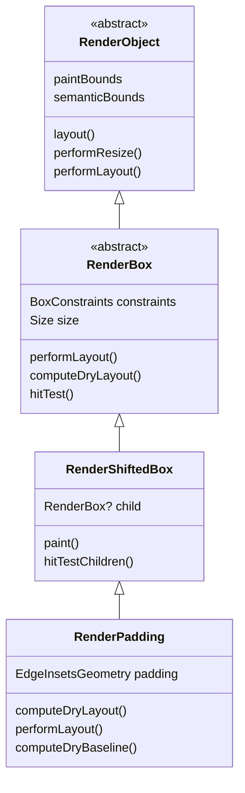
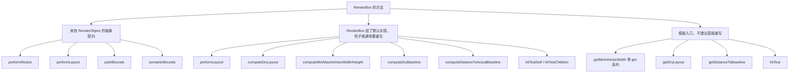
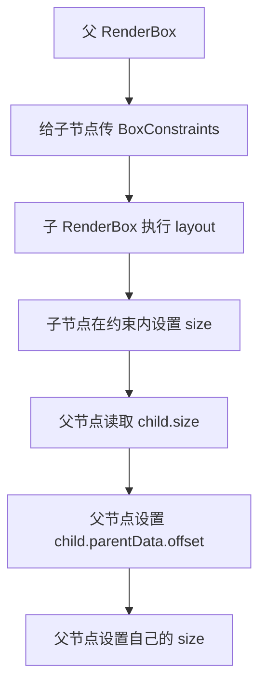
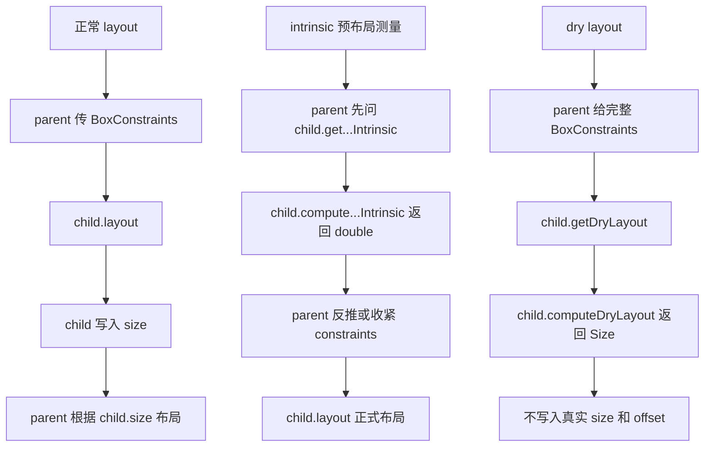
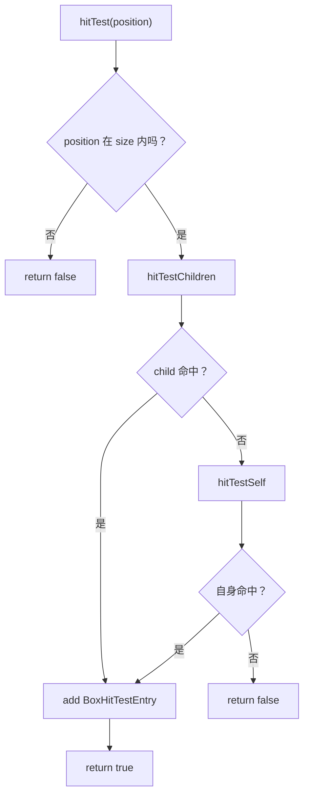
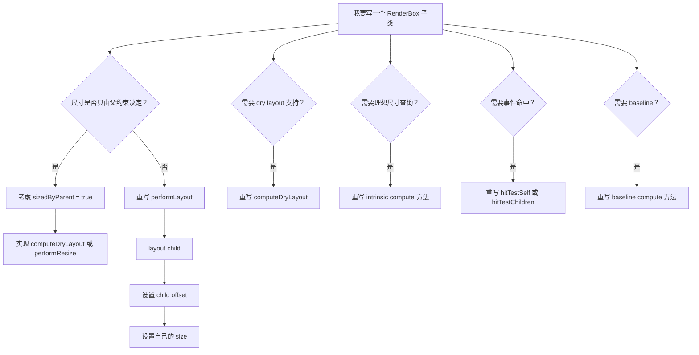
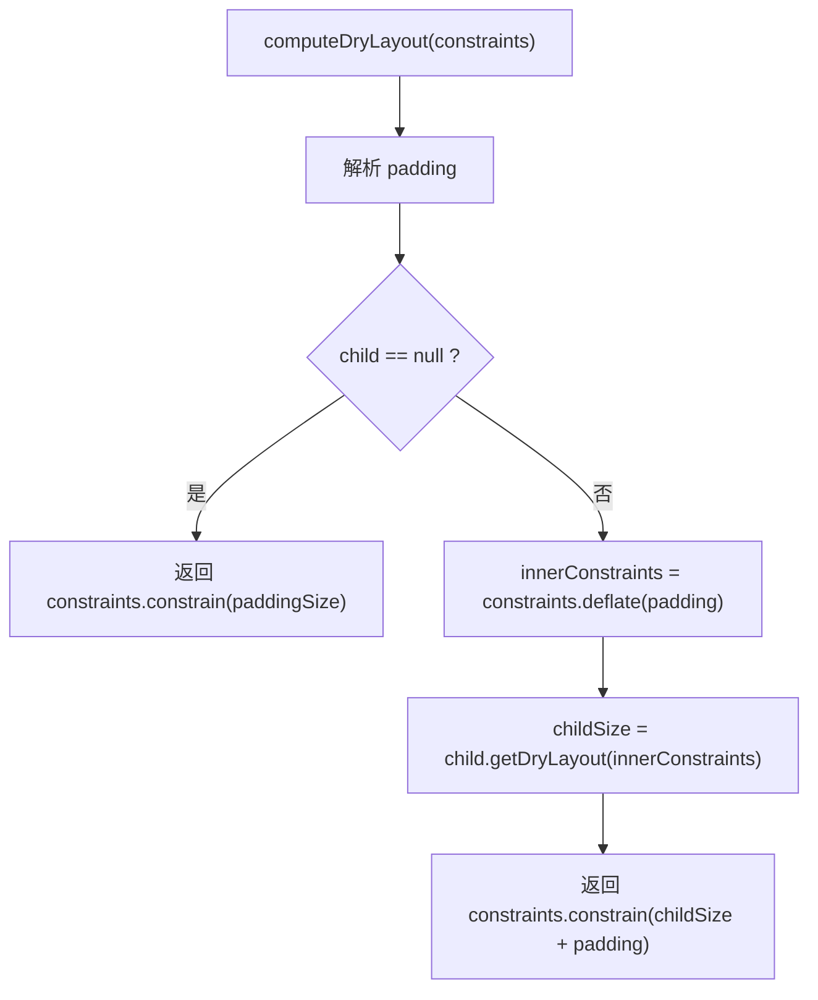
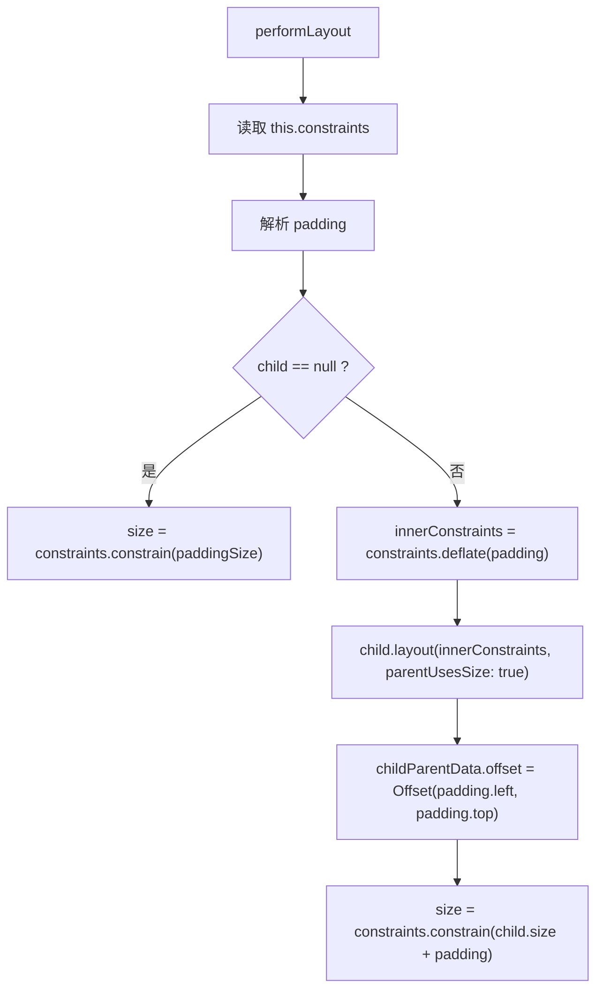

# Flutter RenderBox 源码解析：从抽象契约到 RenderPadding 实现

> 基于 Flutter 3.41.9 stable 源码梳理。不同 Flutter 版本里方法细节可能会调整，但 `RenderBox` 的核心协议基本稳定：父级传约束，子级选尺寸，父级决定位置。

在 Flutter 渲染体系里，`RenderObject` 是所有渲染对象的基类，而 `RenderBox` 是最常见的一类二维盒模型渲染对象。

平时我们写的 `Container`、`Padding`、`Align`、`SizedBox`、`Text`，最终大多都会落到某个 `RenderBox` 子类上。理解 `RenderBox`，其实就是理解 Flutter 布局系统最核心的一套规则。

本文重点不只是列方法，而是回答一个问题：

> `abstract class RenderBox extends RenderObject` 里的“抽象”到底抽象在哪里？子类到底应该重写什么？

## 1. 先看整体继承关系

你贴的源码是 `RenderPadding`，它不是直接继承 `RenderObject`，而是走了这样一条链路：



这条链可以简单理解为：

| 类 | 作用 |
| --- | --- |
| `RenderObject` | 渲染树的基础协议，负责布局、绘制、语义、脏标记等通用能力 |
| `RenderBox` | 把通用协议落到二维盒模型：`BoxConstraints`、`Size`、坐标转换、命中测试 |
| `RenderShiftedBox` | 管理一个 `RenderBox` 子节点，并支持给子节点一个偏移量 |
| `RenderPadding` | 在子节点外面加一圈 padding，本质是“缩小子约束，再放大自身尺寸” |

## 2. RenderBox 的 abstract 不等于每个核心方法都是抽象方法

很多人看到这行源码：

```dart
abstract class RenderBox extends RenderObject {
  // ...
}
```

会下意识认为：`RenderBox` 里面应该有很多 Dart 语法上的抽象方法。

但实际源码不是这样。

`RenderBox` 里面大量方法已经有默认实现，只是这些默认实现更多是“协议兜底”或“模板入口”。真正写自定义 `RenderBox` 时，你重写的通常不是入口方法，而是入口方法背后的计算钩子。

先用一张表把“抽象方法”这件事说透：

| 方法 | 在 `RenderObject` 中的状态 | `RenderBox` 中的处理 | 子类通常怎么做 |
| --- | --- | --- | --- |
| `performResize()` | 抽象方法 | 给默认实现，默认用 `computeDryLayout(constraints)` 设置 `size` | 只有 `sizedByParent == true` 的场景才重点关注 |
| `performLayout()` | 抽象方法 | 给默认实现，但普通盒子不重写会在 debug 下报错 | 大多数自定义 `RenderBox` 必须重写 |
| `paintBounds` | 抽象 getter | 默认返回 `Offset.zero & size` | 绘制超出自身尺寸时重写 |
| `semanticBounds` | 抽象 getter | 默认返回 `Offset.zero & size` | 语义区域不同于布局尺寸时重写 |
| `paint()` | 非抽象，默认空实现 | `RenderBox` 没有强制改写 | 自己需要画内容时重写 |
| `hitTest()` | `RenderBox` 自己提供模板入口 | 负责范围判断、调用 child/self 命中逻辑 | 通常不直接重写 |

所以，`RenderBox` 的“抽象重点”不只是 Dart 语法上的 `abstract method`，更重要的是它把二维盒模型拆成了一组必须遵守的协议点。

可以把它分成三类：



这里最容易混淆：

`RenderObject` 里有一些抽象契约，比如 `performLayout`、`paintBounds`、`semanticBounds`。`RenderBox` 对它们给了盒模型版本的默认实现，所以子类不一定有编译期强制实现。

但是如果你真的写一个普通 `RenderBox` 子类，不重写 `performLayout`，运行时布局阶段就会报错。因为默认实现的目的不是帮你完成布局，而是告诉你：“你这个盒子还没有定义自己的布局算法”。

## 3. RenderBox 的核心协议：约束向下，尺寸向上

`RenderBox` 的布局模型可以用一句话概括：

> 父节点把 `BoxConstraints` 传给子节点，子节点必须在约束范围内选择一个 `Size`，父节点再决定子节点的位置。

流程大概是这样：



这套规则里，`RenderBox` 关心四个核心对象：

| 对象 | 含义 |
| --- | --- |
| `BoxConstraints` | 父节点给出的宽高范围：最小宽、最大宽、最小高、最大高 |
| `Size` | 当前盒子最终占据的尺寸 |
| `BoxParentData.offset` | 子节点相对父节点左上角的绘制偏移 |
| `PaintingContext` | 绘制阶段使用的上下文 |

## 4. 真正需要重点理解的“抽象契约”

下面这些方法，才是读 `RenderBox` 时最应该抓住的主线。

### 4.1 performLayout：普通 RenderBox 最核心的布局方法

`performLayout` 是写自定义 `RenderBox` 时最重要的方法。

它的责任是：

1. 根据当前 `constraints` 计算自己的 `size`
2. 如果有 child，调用 `child.layout(...)`
3. 如果需要使用 child 的尺寸，传 `parentUsesSize: true`
4. 如果有 child，还要设置 child 的 `parentData.offset`

简化后的写法通常像这样：

```dart
@override
void performLayout() {
  if (child == null) {
    size = constraints.smallest;
    return;
  }

  child!.layout(constraints, parentUsesSize: true);

  final childParentData = child!.parentData! as BoxParentData;
  childParentData.offset = Offset.zero;

  size = constraints.constrain(child!.size);
}
```

这里有两个坑很常见。

第一个坑：忘记设置 `size`。

`RenderBox` 的布局必须产生尺寸。如果布局结束后 `size` 还是空，Flutter 会抛出类似 “RenderBox did not set its size during layout” 的错误。

第二个坑：读了 `child.size`，但没有传 `parentUsesSize: true`。

因为 Flutter 需要知道父节点是否依赖子节点尺寸。如果父节点依赖子节点尺寸，子节点尺寸变化时父节点也要重新布局。

也就是说：

```dart
child!.layout(innerConstraints, parentUsesSize: true);
final Size childSize = child!.size;
```

这是一组配套动作。

### 4.2 performResize：sizedByParent 场景的尺寸计算

`performResize` 来自 `RenderObject` 的抽象布局契约。`RenderBox` 给了默认实现：

```dart
@override
void performResize() {
  size = computeDryLayout(constraints);
}
```

它主要服务于 `sizedByParent == true` 的渲染对象。

什么叫 `sizedByParent`？

就是这个盒子的尺寸只由父节点给的约束决定，不需要看 child 的布局结果。例如某些总是撑满约束的盒子，可以把尺寸计算放在 `performResize` 里。

对大多数自定义 `RenderBox` 来说，你更常重写的是 `performLayout`，不是 `performResize`。

可以这样记：

| 场景 | 通常重写 |
| --- | --- |
| 尺寸需要看 child | `performLayout` |
| 尺寸只由父约束决定 | `sizedByParent = true` + `computeDryLayout` 或 `performResize` |

### 4.3 computeDryLayout：不真正布局，也能预测尺寸

`computeDryLayout` 是近几年 Flutter 布局系统里非常重要的一个方法。

它的意思是 dry layout，也就是“干布局”。它只根据传入的 `BoxConstraints` 计算如果真的布局会得到什么 `Size`，但不能产生副作用。

不能做的事情包括：

| 禁止行为 | 原因 |
| --- | --- |
| 修改自己的 `size` | dry layout 只是预测，不能改变真实布局状态 |
| 修改 child 的 offset | 会影响后续绘制和命中测试 |
| 读取当前 `size` 或 `child.size` | 当前尺寸可能来自另一套 constraints |
| 调用会改变布局状态的 child layout | 破坏 dry layout 的无副作用契约 |

正确方式是问 child 的 dry layout：

```dart
@override
Size computeDryLayout(BoxConstraints constraints) {
  final Size childSize = child?.getDryLayout(constraints) ?? Size.zero;
  return constraints.constrain(childSize);
}
```

注意这里调用的是 `child.getDryLayout(...)`，不是 `child.computeDryLayout(...)`。

这是 `RenderBox` 的一个重要设计：

> 对外调用 `get...` 入口，让框架做缓存、断言、依赖追踪；子类只重写 `compute...` 钩子。

### 4.4 四个 intrinsic 方法：正式布局前的“预布局测量”

正常布局你已经很清楚了：

```text
父节点给 constraints -> child.layout -> child 设置 size -> 父节点根据 child.size 算自己的 size
```

但是有些组件会遇到一个反过来的问题：

> 父节点还没法决定该给 child 什么约束，因为它需要先知道 child 的内容自然想要多大。

这时就会进入 intrinsic 测量流程。它不是 child 自己主动执行，也不是替代正式 layout，而是父节点在正式 `child.layout(...)` 前先发起一次询问：

```text
父节点调用 child.get...Intrinsic...
-> RenderBox 做检查、缓存、依赖追踪
-> 转到 child.compute...Intrinsic...
-> 父节点拿到自然尺寸
-> 父节点据此收紧 constraints
-> 再执行正式 child.layout(...)
```

一张图看清三种流程的区别：



#### 4.4.1 这四个方法到底回答什么问题

`RenderBox` 里有四个 intrinsic 计算方法：

| 方法 | 它在问什么 | 以 `Text("Hello Flutter")` 理解 |
| --- | --- | --- |
| `computeMinIntrinsicWidth(double height)` | 给定高度时，最窄需要多宽才能正确绘制 | 近似最长单词宽度，比如 `Flutter` 的宽度 |
| `computeMaxIntrinsicWidth(double height)` | 给定高度时，自然状态最想要多宽 | 近似整句话不换行的宽度 |
| `computeMinIntrinsicHeight(double width)` | 给定宽度时，至少需要多高才能放下内容 | 宽度变窄后，文字换行需要的高度 |
| `computeMaxIntrinsicHeight(double width)` | 给定宽度时，完整自然绘制需要多高 | 对文本来说通常接近排版后的完整高度 |

注意返回值都是 `double`，因为它们一次只回答一个方向的问题。

它们对应的公共入口是：

```dart
getMinIntrinsicWidth(height)
getMaxIntrinsicWidth(height)
getMinIntrinsicHeight(width)
getMaxIntrinsicHeight(width)
```

子类应该重写 `compute...`，不要直接重写 `get...`。

原因是 `get...` 这一层负责做框架级工作：

1. 参数合法性检查，比如不能传负数
2. intrinsic 结果缓存
3. layout 依赖追踪
4. debug timeline 统计

#### 4.4.2 Intrinsic 能解决什么问题

Intrinsic 主要解决这类问题：

| 问题 | 普通 layout 的难点 | intrinsic 的作用 |
| --- | --- | --- |
| 内容自然宽度 | 父节点默认可能给很宽，child 被迫撑开 | 先问 child 自然想要多宽，再收紧 width |
| 同组子项等宽 | 每个 child 正常 layout 后宽度各不相同 | 先找最宽 child，再让其它 child 按它对齐 |
| 同组子项等高 | `Row` 内部分割线不知道整行最高内容有多高 | 先问整行自然高度，再收紧 height |
| 表格按内容算列宽 | 列宽要由同一列所有 cell 决定 | 先问每个 cell 的 intrinsic width，再算列宽 |
| 父级根据 child 内容反推约束 | 正常流程是父约束先下发，无法先知道 child 自然尺寸 | 增加一次正式布局前的询问 |

它不能解决所有复杂自适应布局问题。很多时候应该优先用更便宜的方式：

```dart
Expanded
Flexible
SizedBox
ConstrainedBox
CrossAxisAlignment.stretch
```

如果这些能表达布局意图，就不要为了“自动测内容”而上 intrinsic。

#### 4.4.3 哪些组件会触发 intrinsic 方法

下面这些是最常见的触发者。

| 组件或布局 | 会问什么 | 什么时候触发 |
| --- | --- | --- |
| `IntrinsicWidth` | `child.getMaxIntrinsicWidth(...)` | 想让 child 宽度按内容自然宽度，而不是撑满父级 |
| `IntrinsicHeight` | `child.getMaxIntrinsicHeight(...)` | 想让 child 高度按内容自然高度，比如 `Row` 等高 |
| `Table + IntrinsicColumnWidth` | cell 的 `getMinIntrinsicWidth` / `getMaxIntrinsicWidth` | 表格列宽需要由这一列内容决定 |
| `Row` / `Column` | 继续问 children 的 intrinsic 方法 | 它们被上层 intrinsic 查询时才会传递下去 |
| `Text` | `RenderParagraph.compute...Intrinsic...` | 通常作为最终被询问的内容节点 |

重点是：普通 `Row`、`Column` 正常布局时，一般不会自己突然走 intrinsic。

比如：

```dart
Row(
  children: [
    Text('A'),
    Text('B'),
  ],
)
```

正常就是 `RenderFlex.performLayout -> child.layout -> child.size`。

但是如果外面套了 `IntrinsicHeight`：

```dart
IntrinsicHeight(
  child: Row(
    children: [
      Text('A'),
      Text('B'),
    ],
  ),
)
```

外层 `RenderIntrinsicHeight` 会先问 `Row` 的自然高度，于是 `Row` 背后的 `RenderFlex.computeMaxIntrinsicHeight` 才会被调用，然后 `RenderFlex` 再继续问每个 child。

#### 4.4.4 完整例子：IntrinsicHeight 让 Row 里的分割线等高

看一个典型场景：

```dart
IntrinsicHeight(
  child: Row(
    children: [
      Text('左边\n两行'),
      VerticalDivider(width: 1),
      Text('右边'),
    ],
  ),
)
```

这个例子想解决的问题是：

> `VerticalDivider` 想和 `Row` 中最高的内容一样高。

普通 `Row` 的布局是横向排 child。它在正式 layout 前，并不会天然知道整行最终自然高度是多少。尤其是中间这个 `VerticalDivider`，它想撑到整行高度，但这个“整行高度”又取决于旁边文本排版后的高度。

`IntrinsicHeight` 的做法是：正式布局前先问一次 `Row` 的自然高度。

调用链可以这样看：

```text
RenderIntrinsicHeight.performLayout
-> _childConstraints(child, constraints)
-> child.getMaxIntrinsicHeight(constraints.maxWidth)
-> RenderBox.getMaxIntrinsicHeight
-> RenderFlex.computeMaxIntrinsicHeight
-> RenderFlex 继续问 children.getMaxIntrinsicHeight(...)
-> Text 背后的 RenderParagraph 计算文字高度
-> 得到 Row 的自然高度
-> constraints.tighten(height: 自然高度)
-> child.layout(tightenedConstraints)
-> RenderFlex.performLayout 正式布局
```

对应到源码思想就是：

```dart
BoxConstraints _childConstraints(RenderBox child, BoxConstraints constraints) {
  return constraints.hasTightHeight
      ? constraints
      : constraints.tighten(
          height: child.getMaxIntrinsicHeight(constraints.maxWidth),
        );
}
```

所以 `IntrinsicHeight` 的关键不是“直接把高度变高”，而是：

1. 先问 child 的自然高度
2. 用自然高度生成更紧的高度约束
3. 再让 child 按这个新约束正式布局

这就是为什么它适合小范围 UI，比如设置页的一行、弹窗里的少量内容、表单中的局部分割线；但不适合在长列表 item 中大量使用。

#### 4.4.5 Intrinsic 和 computeDryLayout 的关系

`computeDryLayout` 和这四个 intrinsic 方法都属于“不直接修改真实布局状态”的测量能力，但回答的问题不一样。

| 方法 | 入参 | 返回 | 回答的问题 | 典型用途 |
| --- | --- | --- | --- | --- |
| intrinsic 四方法 | 一个方向的假设值，比如 height 或 width | `double` | 某个方向自然需要多少 | 帮父节点反推约束 |
| `computeDryLayout` | 完整 `BoxConstraints` | `Size` | 如果给我这组约束，我最终会是什么尺寸 | 预测真实 layout 结果 |
| `performLayout` | 当前真实 `constraints` | 写入 `size` | 真正执行布局，确定尺寸和 child offset | 正式布局 |

用一句话区分：

```text
intrinsic = 在约束还没完全定下来前，问自然尺寸
dry layout = 约束已经给完整了，预测最终 Size
performLayout = 真正布局，写入 size 和 parentData.offset
```

比如：

```dart
child.getMaxIntrinsicWidth(double.infinity)
```

问的是：

> 你在不受宽度限制时，自然想要多宽？

而：

```dart
child.getDryLayout(BoxConstraints(maxWidth: 200))
```

问的是：

> 如果正式给你最大宽度 200，你预测自己的完整 `Size` 是多少？

所以 intrinsic 常用于“决定约束之前”，`computeDryLayout` 常用于“已有约束之后”。

intrinsic 方法为什么要谨慎使用？

因为它可能很贵。父节点为了知道一个 child 的自然尺寸，会向 child 提问；child 又可能继续向自己的 child 提问。整棵树上如果频繁做 intrinsic 查询，可能出现 `O(N^2)` 级别的布局成本。

所以读源码时看到 `IntrinsicWidth`、`IntrinsicHeight`、`IntrinsicColumnWidth` 这类组件，要知道它们不是普通布局，它们会额外触发这类尺寸查询。

### 4.5 baseline 方法：用于文本基线对齐

baseline 是排版系统里的概念，常见于文本对齐。

比如一行里有多个不同字号的文字，要让它们看起来“底线对齐”，就需要知道每个盒子的 baseline 距离顶部有多远。

`RenderBox` 里有两组 baseline 方法：

| 方法 | 使用场景 |
| --- | --- |
| `getDistanceToBaseline` | 真实布局之后查询当前 baseline |
| `computeDistanceToActualBaseline` | 子类重写，计算真实 baseline |
| `getDryBaseline` | 不真正布局，预测某个 constraints 下的 baseline |
| `computeDryBaseline` | 子类重写，计算 dry baseline |

仍然是同一个原则：

> 外部调用 `get...`，子类重写 `compute...`。

如果一个盒子没有 baseline，可以返回 `null`。

如果它只是把 baseline 转发给 child，就要把 child 的偏移算进去。比如 `RenderShiftedBox` 会在 child baseline 的基础上加上 child 的 `offset.dy`。

而 `RenderPadding` 更明确：child 被向下移动了 `padding.top`，所以 baseline 也要加上 `padding.top`。

### 4.6 hitTest：命中测试入口固定，子类重写局部判断

`hitTest` 用于判断某个坐标点是否点中了当前 `RenderBox` 或它的子节点。

`RenderBox.hitTest` 的核心流程是固定的：



所以一般不建议直接重写 `hitTest`，而是重写：

| 方法 | 作用 |
| --- | --- |
| `hitTestSelf(Offset position)` | 当前盒子自身是否响应事件 |
| `hitTestChildren(BoxHitTestResult result, {required Offset position})` | 子节点是否响应事件 |

默认情况下：

```dart
bool hitTestSelf(Offset position) => false;
bool hitTestChildren(BoxHitTestResult result, {required Offset position}) => false;
```

这意味着一个空的 `RenderBox` 默认不会被命中。像按钮、手势区域、可点击图形等需要响应事件的渲染对象，才会重写这些方法。

### 4.7 paintBounds 和 semanticBounds：RenderBox 给了盒模型默认值

`paintBounds` 和 `semanticBounds` 是 `RenderObject` 的抽象契约。

`RenderBox` 默认都用当前盒子的大小来描述：

```dart
Rect get paintBounds => Offset.zero & size;
Rect get semanticBounds => Offset.zero & size;
```

这适合大多数普通盒子。

但如果你的渲染对象会画出自身 size 之外的内容，比如阴影、发光、外扩路径，就可能需要重写 `paintBounds`，告诉框架实际绘制范围更大。

`semanticBounds` 则影响无障碍语义区域。普通盒子通常不需要改。

### 4.8 applyPaintTransform、globalToLocal、localToGlobal：坐标系统转换

`RenderBox` 还提供坐标转换能力。

常用的是：

```dart
globalToLocal(globalPosition)
localToGlobal(localPosition)
```

它们底层依赖 `getTransformTo` 和 `applyPaintTransform`。

默认的 `applyPaintTransform` 会读取 child 的 `BoxParentData.offset`，把 child 相对父节点的偏移加入矩阵。

这就是为什么布局阶段设置 offset 很重要：

```dart
final childParentData = child!.parentData! as BoxParentData;
childParentData.offset = Offset(x, y);
```

这个 offset 不只影响 paint，还会影响 hit test、坐标转换、语义位置。

## 5. 一张图总结 RenderBox 的重写规则



一句话总结：

> `RenderBox` 的公共入口大多已经写好，子类要做的是补上自己的布局算法、尺寸预测、命中判断和绘制规则。

## 6. RenderPadding 如何重写 RenderBox 的抽象契约

现在回到你贴的 `RenderPadding`。

它的核心逻辑非常纯粹：

> padding 会占掉一部分空间，所以给 child 的约束要减去 padding；child 布局完成后，自己的尺寸再加回 padding。

### 6.1 padding 先 resolve，再缓存

`RenderPadding` 接收的是 `EdgeInsetsGeometry`，它可能是方向相关的，比如 `EdgeInsetsDirectional`。

所以源码里先把它解析成真正的 `EdgeInsets`：

```dart
EdgeInsets get _resolvedPadding {
  return _resolvedPaddingCache ??= padding.resolve(textDirection);
}
```

如果 `padding` 或 `textDirection` 变了，就清缓存并重新布局：

```dart
void _markNeedResolution() {
  _resolvedPaddingCache = null;
  markNeedsLayout();
}
```

这体现了一个很重要的渲染对象规则：

> 影响布局结果的属性变化，必须调用 `markNeedsLayout()`。

因为 padding 变化后，child 能拿到的约束、自身 size、child offset 都可能变。

### 6.2 intrinsic：减掉 padding 问 child，再加回来

以 `computeMinIntrinsicWidth` 为例，`RenderPadding` 的逻辑是：

```dart
final EdgeInsets padding = _resolvedPadding;
return child.getMinIntrinsicWidth(height - padding.vertical)
     + padding.horizontal;
```

注意这里的方向：

如果要问“给定高度下最小宽度是多少”，那 child 能使用的高度要先减掉上下 padding：

```text
child 可用高度 = 外部给定高度 - padding.top - padding.bottom
最终宽度 = child 最小宽度 + padding.left + padding.right
```

四个 intrinsic 方法都遵循同一个规则：

| 方法 | 传给 child 前先减 | child 结果后再加 |
| --- | --- | --- |
| `computeMinIntrinsicWidth(height)` | `padding.vertical` | `padding.horizontal` |
| `computeMaxIntrinsicWidth(height)` | `padding.vertical` | `padding.horizontal` |
| `computeMinIntrinsicHeight(width)` | `padding.horizontal` | `padding.vertical` |
| `computeMaxIntrinsicHeight(width)` | `padding.horizontal` | `padding.vertical` |

这里用 `math.max(0.0, value)` 是为了防止 padding 比外部给定空间还大时传给 child 负数。

### 6.3 computeDryLayout：无副作用地模拟真实布局

`RenderPadding.computeDryLayout` 和真实布局逻辑几乎一一对应，只是不写入 `size` 和 child offset。

流程如下：



简化代码：

```dart
@override
Size computeDryLayout(BoxConstraints constraints) {
  final EdgeInsets padding = _resolvedPadding;

  if (child == null) {
    return constraints.constrain(
      Size(padding.horizontal, padding.vertical),
    );
  }

  final BoxConstraints innerConstraints = constraints.deflate(padding);
  final Size childSize = child!.getDryLayout(innerConstraints);

  return constraints.constrain(
    Size(
      padding.horizontal + childSize.width,
      padding.vertical + childSize.height,
    ),
  );
}
```

这里的关键点有两个：

1. 用 `constraints.deflate(padding)` 生成 child 的约束
2. 用 `child.getDryLayout(...)`，不直接碰 child 的真实 `size`

这正好符合 `computeDryLayout` 的无副作用契约。

### 6.4 computeDryBaseline：child baseline 加上 padding.top

padding 会把 child 往右下方移动。

所以 baseline 的垂直距离也要增加：

```dart
final double? childBaseline = child.getDryBaseline(
  innerConstraints,
  baseline,
);

return childBaseline == null
    ? null
    : childBaseline + padding.top;
```

为什么只加 `padding.top`？

因为 baseline 是“从当前盒子顶部到文本基线的垂直距离”。左右 padding 不影响这个垂直距离，底部 padding 也不影响 child 基线相对顶部的位置。

### 6.5 performLayout：真实布局时设置 child offset 和自身 size

`RenderPadding.performLayout` 是最值得重点看的地方。

它完整体现了 `RenderBox` 的布局协议：



简化代码：

```dart
@override
void performLayout() {
  final BoxConstraints constraints = this.constraints;
  final EdgeInsets padding = _resolvedPadding;

  if (child == null) {
    size = constraints.constrain(
      Size(padding.horizontal, padding.vertical),
    );
    return;
  }

  final BoxConstraints innerConstraints = constraints.deflate(padding);
  child!.layout(innerConstraints, parentUsesSize: true);

  final childParentData = child!.parentData! as BoxParentData;
  childParentData.offset = Offset(padding.left, padding.top);

  size = constraints.constrain(
    Size(
      padding.horizontal + child!.size.width,
      padding.vertical + child!.size.height,
    ),
  );
}
```

这段代码可以拆成三句人话：

1. child 不能占用 padding 区域，所以先把约束缩小
2. child 画的位置要避开左上 padding，所以 offset 是 `(left, top)`
3. 当前 padding 盒子的尺寸等于 child 尺寸加上横向、纵向 padding

也正因为它会读取 `child!.size`，所以调用 child layout 时必须传：

```dart
parentUsesSize: true
```

### 6.6 RenderPadding 没有重写 paint，是因为父类已经够用

你贴的 `RenderPadding` 没有重写 `paint`。

原因在它的父类 `RenderShiftedBox`。

`RenderShiftedBox` 已经实现了单 child 的绘制逻辑：

```dart
context.paintChild(child, childParentData.offset + offset);
```

`RenderPadding` 在布局阶段已经把 child 的 offset 设置成：

```dart
Offset(padding.left, padding.top)
```

所以绘制阶段直接复用父类逻辑就可以了。

这也是 Flutter render object 设计里很漂亮的一点：

> 子类只重写自己改变的规则。`RenderPadding` 改的是布局约束和 child 偏移，不需要重新发明单 child 绘制逻辑。

### 6.7 RenderPadding 也没有重写 hitTestChildren

同理，`RenderPadding` 也没有自己写 hit test。

`RenderShiftedBox` 已经根据 `childParentData.offset` 做了坐标转换：

```dart
return result.addWithPaintOffset(
  offset: childParentData.offset,
  position: position,
  hitTest: (result, transformed) {
    return child.hitTest(result, position: transformed);
  },
);
```

因为 `RenderPadding.performLayout` 已经设置好了 child offset，所以 hit test 阶段自然能把父坐标转换成 child 坐标。

这说明 `BoxParentData.offset` 同时服务于：

| 阶段 | 作用 |
| --- | --- |
| paint | 决定 child 画在哪里 |
| hit test | 把父坐标转换成 child 坐标 |
| transform | 支持 `localToGlobal`、`globalToLocal` |
| semantics | 帮助计算语义节点位置 |

### 6.8 debugPaintSize 和 debugFillProperties

`RenderPadding` 最后还重写了两个 debug 相关方法：

| 方法 | 作用 |
| --- | --- |
| `debugPaintSize` | debug 模式下画出 padding 区域 |
| `debugFillProperties` | DevTools 或日志里展示 `padding`、`textDirection` |

这两个不影响正式布局和绘制逻辑，但对调试很有帮助。

## 7. 用一句公式记住 RenderPadding

`RenderPadding` 的全部核心逻辑可以压缩成一个公式：

```text
childConstraints = parentConstraints - padding
childOffset      = Offset(padding.left, padding.top)
selfSize         = childSize + padding
```

对应到源码就是：

```dart
final BoxConstraints innerConstraints = constraints.deflate(padding);

child!.layout(innerConstraints, parentUsesSize: true);

childParentData.offset = Offset(padding.left, padding.top);

size = constraints.constrain(
  Size(
    padding.horizontal + child!.size.width,
    padding.vertical + child!.size.height,
  ),
);
```

这就是 `Padding` 为什么能在视觉上把 child 往内部推一圈。

## 8. 自定义 RenderBox 时到底该重写哪些方法

最后给一个实践版速查表。

| 需求 | 优先重写 |
| --- | --- |
| 定义布局规则 | `performLayout` |
| 支持 dry layout | `computeDryLayout` |
| 支持 intrinsic 尺寸 | 四个 `compute...Intrinsic...` 方法 |
| 支持文本基线 | `computeDistanceToActualBaseline`、`computeDryBaseline` |
| 自己能被点中 | `hitTestSelf` |
| 子节点能被点中 | `hitTestChildren` |
| 自己要画内容 | `paint` |
| 绘制超出自身 size | `paintBounds` |
| 子节点使用特殊 ParentData | `setupParentData`、`applyPaintTransform` |
| 属性变化影响布局 | setter 里调用 `markNeedsLayout()` |
| 属性变化只影响绘制 | setter 里调用 `markNeedsPaint()` |

不要优先重写这些模板入口：

| 不建议直接重写 | 应该重写 |
| --- | --- |
| `getMinIntrinsicWidth` | `computeMinIntrinsicWidth` |
| `getMaxIntrinsicWidth` | `computeMaxIntrinsicWidth` |
| `getMinIntrinsicHeight` | `computeMinIntrinsicHeight` |
| `getMaxIntrinsicHeight` | `computeMaxIntrinsicHeight` |
| `getDryLayout` | `computeDryLayout` |
| `getDryBaseline` | `computeDryBaseline` |
| `getDistanceToBaseline` | `computeDistanceToActualBaseline` |
| `hitTest` | `hitTestSelf`、`hitTestChildren` |

如果你的 RenderObject 会被 `IntrinsicWidth`、`IntrinsicHeight`、`Table`、`Row`、`Column` 等组件询问自然尺寸，就要认真实现 intrinsic 方法。否则默认返回 `0.0`，上层用 intrinsic 反推约束时就会得到错误结果。

## 9. 总结

`RenderBox` 的“抽象”不是说它里面每个重要方法都是 Dart 语法上的抽象方法。

更准确地说：

> `RenderBox` 抽象的是二维盒模型的协议：约束怎么传，尺寸怎么定，child 怎么摆，命中测试怎么走，坐标怎么转换。

读源码时要抓住这条主线：

1. `BoxConstraints` 是父节点给子节点的尺寸范围
2. `size` 是当前盒子必须在布局阶段确定的结果
3. `performLayout` 是普通 `RenderBox` 最核心的布局实现点
4. `computeDryLayout` 是无副作用的尺寸预测
5. intrinsic 方法是正式布局前的自然尺寸询问，用来帮助父节点反推约束
6. baseline 服务于文本基线对齐
7. hit test 的入口固定，子类通常只重写局部判断
8. `RenderPadding` 的本质是 deflate constraints、offset child、inflate size

如果你能把 `RenderPadding` 这类简单 render object 读透，再去看 `RenderAligningShiftedBox`、`RenderPositionedBox`、`RenderFlex`，就会发现它们其实都在同一套协议下做不同的布局算法。
