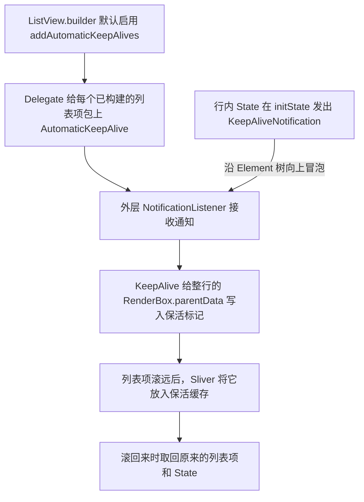

# Flutter ListView.builder 和 KeepAlive：为什么列表项滑回来后计数归零？

打开 Flutter Study 首页的 **List Item Page**（`/list_item_page`），在下半部分给第一项点几次 **+**。向下滚远一点，再滚回顶部。普通模式可能归零，KeepAlive 和数据模型模式则能保留计数。切换模式后，重新给第一项加计数，再分别做一遍。

对应代码见 [ListItemPage.dart](ListItemPage.dart)。本文沿 Flutter 3.41.9 的源码解释这三种结果。

## 什么时候用 ListView.builder？

需要把一组内容沿一个方向排列并滚动时，可以用 `ListView`。设置页的几个固定入口适合直接写 `ListView(children: ...)`，接口返回的商品列表、聊天记录等大量重复项适合用 `ListView.builder`。

| 写法 | 列表项的 Widget 配置如何创建 |
| --- | --- |
| `ListView(children: ...)` | 调用方先准备整份 `List<Widget>` |
| `ListView.builder` | Flutter 需要某个索引的列表项时，才调用 `itemBuilder` |

两种写法都会按需挂载列表项。滚动时，`Scrollable` 管理手势和滚动位置，`Viewport` 提供视口及其附近的缓存范围，`Sliver` 据此按需创建和布局子项。所以某一项可能还没滑到屏幕里就已经执行了 `initState()`，也可能刚滑出去时仍然留在缓存范围内。

`ListView.builder` 节省的是提前创建所有列表项 Widget 的开销。已经加载到内存里的数据仍由你的数据层管理，接口分页也由应用负责。 [Flutter 官方文档 · ListView](https://api.flutter.dev/flutter/widgets/ListView-class.html)

## 用当前页面观察三种状态

| 模式 | 计数存放位置 | 滚远再回来 |
| --- | --- | --- |
| 普通 | `CounterItem` 自己的 `State._count` | 滚到触发 `dispose()` 后，再回来会创建新 State，计数回到 0 |
| KeepAlive | `KeepAliveCounterItem` 自己的 `State._count` | 整行子树被保留，回来时继续使用同一个 State |
| 数据模型 | 页面持有的 `ItemModel.count` | 行可以销毁重建，新行从模型读回当前计数 |

普通和 KeepAlive 模式都有 `initState()`、`dispose()` 日志。普通模式要滚到足够远再回来，才能看到同一项先销毁、后重新创建。两种模式都有 `ValueKey(index)`，Key 用来匹配仍可复用的节点，已经销毁的 State 无法通过 Key 恢复。

## AutomaticKeepAliveClientMixin 怎么用？

下面是 Demo 中 `KeepAliveCounterItem` 的精简写法：

```dart
class _KeepAliveCounterItemState extends State<KeepAliveCounterItem>
    with AutomaticKeepAliveClientMixin<KeepAliveCounterItem> {
  int _count = 0;

  @override
  bool get wantKeepAlive => true;

  @override
  Widget build(BuildContext context) {
    super.build(context);
    return TextButton(
      onPressed: () => setState(() => _count++),
      child: Text('$_count'),
    );
  }
}
```

在需要请求保活的组件的 `State` 上混入 mixin，实现 `wantKeepAlive`，并在 `build()` 中调用 `super.build(context)`。页面 UI 仍由你自己的 `build()` 返回。如果只想保留有计数的项，可以把条件换成 `_count > 0`，在计数跨过 0、保活条件变化后调用 `updateKeepAlive()`。 [Flutter 官方文档 · AutomaticKeepAliveClientMixin](https://api.flutter.dev/flutter/widgets/AutomaticKeepAliveClientMixin-mixin.html)

## 从源码看保活通知何时发出、在哪里接收



### 1. ListView.builder 把参数传给 delegate

`ListView.builder` 的构造参数 `addAutomaticKeepAlives` 默认是 `true`。它把这个值和 `itemBuilder` 一起交给 `SliverChildBuilderDelegate`。Delegate 按需拿到列表项后执行下面这段代码：

```dart
if (addAutomaticKeepAlives) {
  child = AutomaticKeepAlive(child: _SelectionKeepAlive(child: child));
}
```

因此 Demo 三种模式的列表项都有这层包装。 [构造函数 · scroll_view.dart](https://github.com/flutter/flutter/blob/3.41.9/packages/flutter/lib/src/widgets/scroll_view.dart#L1386) · [列表项包装 · scroll_delegate.dart](https://github.com/flutter/flutter/blob/3.41.9/packages/flutter/lib/src/widgets/scroll_delegate.dart#L569)

### 2. Mixin 在 initState 就发通知

当前 Demo 的 `wantKeepAlive` 一直为 `true`。列表项首次挂载时，mixin 在 `initState()` 中调用 `_ensureKeepAlive()`，创建 `KeepAliveHandle`，然后执行 `KeepAliveNotification(...).dispatch(context)`。首次 `build()` 时 handle 已存在。若保活条件之后变化，`updateKeepAlive()` 会按条件建立或释放 handle。 [通知发送 · automatic_keep_alive.dart](https://github.com/flutter/flutter/blob/3.41.9/packages/flutter/lib/src/widgets/automatic_keep_alive.dart#L425)

### 3. 每行外层的 AutomaticKeepAlive 接收通知

`AutomaticKeepAlive` 在自己的 `widget.child` 外面放了这个监听器：

```dart
_child = NotificationListener<KeepAliveNotification>(
  onNotification: _addClient,
  child: widget.child,
);
```

收到通知后，`_addClient()` 登记 handle。外层的 `KeepAlive` 把 `keepAlive` 标记写入整行根 `RenderBox` 的 `parentData`。假如 `itemBuilder` 返回一个 `Card`，mixin 加在 `Card` 内部计数组件的 `State` 上，通知也能沿 Element 树冒泡到这层监听器。只要通知到达这层，保活单位就是 Sliver 管理的整行子树。 [监听器注册 · automatic_keep_alive.dart](https://github.com/flutter/flutter/blob/3.41.9/packages/flutter/lib/src/widgets/automatic_keep_alive.dart#L105) · [标记写入 · KeepAlive.applyParentData](https://api.flutter.dev/flutter/widgets/KeepAlive/applyParentData.html)

### 4. Sliver 在滚远时决定缓存还是移除

当一行离开列表需要的布局范围，`_destroyOrCacheChild()` 读取该行的 `parentData.keepAlive`。标记为 `true` 时，`RenderBox` 会移到按索引保存的 `_keepAliveBucket`，对应的 Element 和 State 继续保留。滚回来时，`_createOrObtainChild()` 优先从缓存取回原来的行。没有保活标记时，Sliver 走移除流程。 [子项缓存与取回 · sliver_multi_box_adaptor.dart](https://github.com/flutter/flutter/blob/3.41.9/packages/flutter/lib/src/rendering/sliver_multi_box_adaptor.dart#L356)

当前 KeepAlive 模式每一行都请求保活，滑过的行越多，保留的组件子树就越多。像购物车数量这种数据，可以像 Demo 的数据模型模式那样存在行外，让列表项保持按需销毁和重建。
